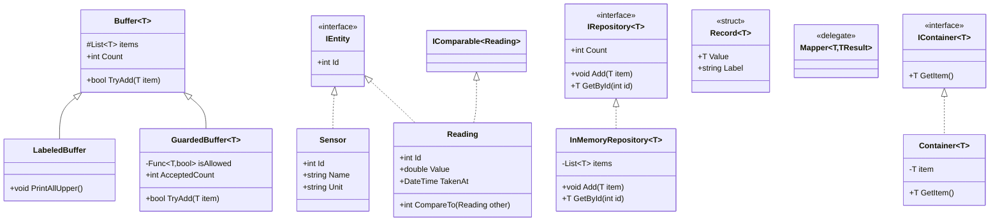
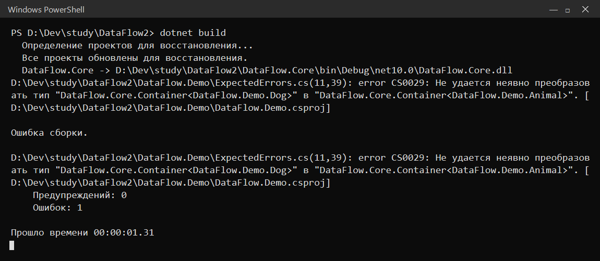
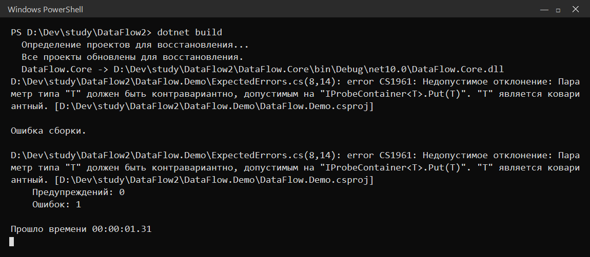
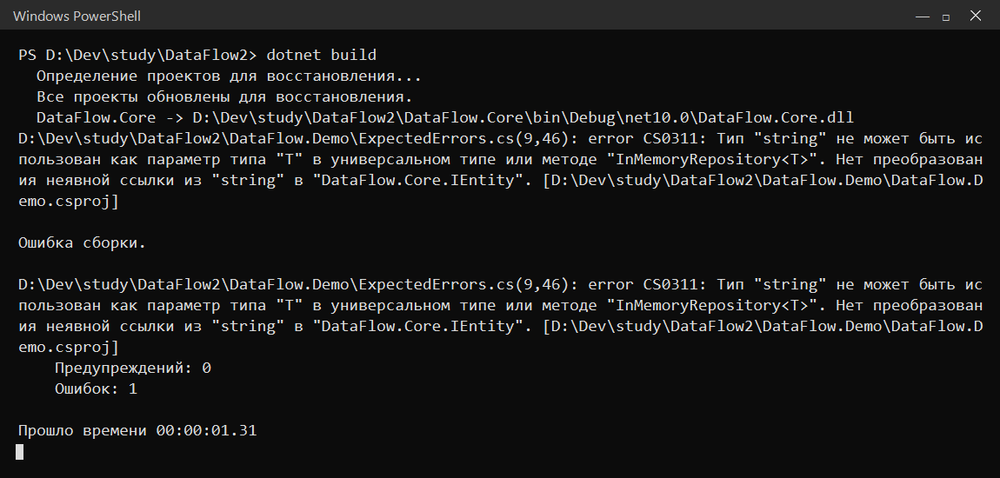

# DataFlow — телеметрия

Объёмное задание КТ27–30 по обобщениям в C#. Сделал библиотеку, которая хранит и обрабатывает однотипные данные, не дублируя код под каждый тип. Домен — вариант 2, телеметрия: датчики и их показания.

## Коротко о проекте

- DataFlow.Core — ядро: `Buffer<T>`, `LabeledBuffer`, `GuardedBuffer<T>`, `Record<T>`, делегат `Mapper`, интерфейсы `IEntity` / `IRepository<T>` / `IContainer<out T>`, `InMemoryRepository<T>`, `Container<T>`, методы расширения `PrintAll` и `FindMax`. Ничего предметного внутри нет.
- DataFlow.Demo — консольное приложение: типы `Sensor` и `Reading`, иерархия `Animal`/`Dog` для ковариантности и сценарий по блокам A–D.

Запуск:

```
dotnet build
dotnet run --project DataFlow.Demo
```

Release собирается без ошибок и предупреждений. Весь вывод лежит в output.txt и продублирован ниже.

## Домен

Вариант 2 — телеметрия.

`Sensor` — датчик: `Id`, `Name`, `Unit`. Реализует `IEntity`, чтобы репозиторий искал по `Id`. Сравнивать датчики между собой смысла нет, поэтому `IComparable` у него нет.

`Reading` — показание: `Id`, `Value`, `TakenAt`. Тоже `IEntity`, плюс `IComparable<Reading>` по `Value`. Благодаря этому `FindMax` по списку показаний возвращает самое высокое значение, а не последнее добавленное.

`Animal` и `Dog` — маленькая иерархия без обобщений, нужна только для демонстрации `IContainer<out T>`.

Сначала думал взять книги, как в примере из методички, но с датчиками удобнее показывать сравнение по числу.

## Схема



Параметр типа зафиксирован только у `LabeledBuffer` (там string). У `GuardedBuffer<T>`, `Record<T>`, `InMemoryRepository<T>` и `Container<T>` он открытый. `IContainer<T>` — ковариантный (`out`), `IRepository<T>` — инвариантный с ограничением `where T : IEntity`.

## Ответы на вопросы

### Шаг 0

1. Чтобы ядро не зависело от конкретных датчиков и показаний. Core — общий инструмент, Demo — приложение под телеметрию. В одном проекте предметные типы переехали бы в библиотеку, и она перестала бы быть переиспользуемой.
2. Demo не увидит типы Core: ссылки между проектами нет. Решение — это контейнер, а не автоматическая зависимость, поэтому `dotnet add reference` вручную.
3. Точка входа есть только у консольного проекта. У библиотеки нет `Main`, поэтому `dotnet run` по ней ничего не запустит.

### Шаг 1

1. `protected` — доступен классу и наследникам. `GuardedBuffer<T>` переопределяет `TryAdd` и обращается к `items` через `base`, а `LabeledBuffer` читает его в `foreach`. Снаружи список должен быть закрыт, иначе можно обойти проверки.
2. `readonly` фиксирует ссылку на список, но не содержимое. `items = new List<T>()` повторно не скомпилируется, а `items.Add(...)` — обычная операция.
3. Пока в базовом классе он всегда `true`: элемент добавляется без условий. В наследнике появится `false`, и вызывающий код сможет отличить отказ от успеха, не ловя исключение.
4. Без `virtual` наследник не переопределит метод, будет ошибка компиляции. Через `new` он просто спрячет базовый, и при вызове через `Buffer<T>` сработает базовая версия — фильтр потеряется.
5. `new()` — target-typed new: тип выводится из поля. `new List<T>()` — то же самое, но тип написан явно. Разницы в результате нет.

### Шаг 2

1. `LabeledBuffer` наследует `Buffer<string>` — параметр типа уже подставлен, класс необобщённый. `GuardedBuffer<T>` наследует `Buffer<T>` — параметр остаётся открытым. Первый — специализация, второй — расширение для любого типа.
2. В `Buffer<T>` у `T` нет метода `ToUpper`: компилятор знает только, что это какой-то тип. `ToUpper` появляется, когда `T` зафиксирован как `string`.
3. Нет. `LabeledBuffer` не принимает параметр типа, он уже наследует `Buffer<string>`. Синтаксис `LabeledBuffer<string>` для него невалиден.
4. `Buffer<object>` смог бы хранить и числа, и строки. Но пришлось бы проверять тип перед `ToUpper`, а в буфер можно было бы положить что угодно. Ошибки переехали бы в рантайм, а главное преимущество обобщений — проверка на компиляции — потерялось бы.

### Шаг 3

1. Сначала проверка, потом добавление: отклонённый элемент не должен попадать в `items`. Иначе его пришлось бы удалять, а это лишний код и лишние ошибки.
2. Если увеличивать счётчик до проверки, он будет считать и отказы. Поэтому `AcceptedCount++` стоит после `if (added)`.
3. `GuardedBuffer<T>` один, но правило задаётся лямбдой: для `Reading` — `r.Value >= 0`, для `Sensor` — непустая единица измерения. Обобщённость в типе, конкретика в делегате.
4. `base.TryAdd(item)` вызывает базовую реализацию и возвращает её результат. Если писать `items.Add(item)` напрямую, логика базового класса дублируется, и изменения в нём не подхватятся.
5. Придётся делать отдельные классы под каждый тип или ветвиться по `typeof(T)`. Делегат в конструкторе переносит выбор правила на вызывающего.

### Шаг 4

1. `struct` — значимый тип: копируется при присваивании и передаче, не может быть null (если не `Nullable<T>`). `class` — ссылочный: копируется ссылка, объект общий, null допустим.
2. Без `ToString` выведется имя типа: ``DataFlow.Core.Record`1[System.Double]``. С переопределением — «Температура: 21,5».
3. `TResult` выводится из возвращаемого типа лямбды: `double` для `c * 9 / 5 + 32`, `string` для `c >= 22 ? "тепло" : "прохладно"`. `T` берётся из `Record<T>`.
4. `Map` один на все пары типов, потому что преобразование передаётся делегатом. Отдельные методы пришлось бы писать под каждую пару, и они дублировали бы код.
5. В выводе будет имя типа вместо значения. Это заметно сразу, так что ошибку легко поймать глазами.

### Шаг 5

1. Компилятор не знает, что у `T` есть `Id`, поэтому `item.Id` не соберётся. Ограничение `where T : IEntity` — это обещание, что `Id` точно есть.
2. Ограничение проверяется компилятором при подстановке типа. В рантайме уже нет неизвестности: неподходящий тип не прошёл бы сборку.
3. `T?` у ссылочного типа — это аннотация «может быть null». `Nullable<T>` — конкретная структура для значимых типов (`int?`). Для обобщённого `T` компилятор трактует `T?` как аннотацию, а не как `Nullable<T>`.
4. CS1961: параметр `out T` нельзя использовать в позиции входа. Ковариантность означает «только отдаём T», а `Put` его принимает. Компилятор такое не пропускает.

### Шаг 6

1. Интерфейс требует `where T : IEntity`, реализация должна повторить ограничение. Иначе внутри `GetById` нельзя будет обратиться к `entity.Id`.
2. Для ссылочного типа `default` — null, для `int` — 0. Поэтому `GetById(99)` вернёт null, а если бы репозиторий был над `int`, вернул бы 0.
3. CS0403: null нельзя привести к `T`, потому что `T` может быть значимым типом. `default` работает и для ссылочных, и для значимых.
4. В `Buffer<T>` список нужен наследникам, поэтому `protected`. В репозитории наследников нет, список — внутренняя деталь, поэтому `private`.

### Шаг 7

1. `IContainer<out T>` разрешает подставить `Container<Dog>` туда, где ждут `IContainer<Animal>`, потому что `T` только возвращается. `Container<T>` — класс, у него вариантность по умолчанию инвариантная, поэтому `Container<Dog>` и `Container<Animal>` — разные типы.
2. `out T` запрещает принимать `T` в методах. Если добавить `Put(T)`, компилятор выдаст CS1961. Поэтому в интерфейсе только `GetItem`.
3. `sealed` закрывает класс от наследников, которые могли бы добавить `Put(T)` и нарушить обещание «только отдаём». Это страховка на уровне типа.
4. Метод `PrintAnimal(IContainer<Animal> box)` примет и `IContainer<Dog>`, и `IContainer<Cat>`. С инвариантным `Container<Animal>` пришлось бы создавать контейнер именно с `Animal`, хотя внутри может лежать `Dog`.

### Шаг 8

1. `List<T>` — не единственный перечислимый тип. Массивы, результаты LINQ, `HashSet<T>` не являются `List<T>`, но их можно перебрать. `IEnumerable<T>` — общий знаменатель.
2. Без ограничения `where T : IComparable<T>` компилятор не знает про `CompareTo`. Ограничение — это и есть разрешение вызвать метод.
3. `Max()` бросает исключение на пустой последовательности. По заданию `FindMax` должен вернуть `default`, поэтому ручной цикл с флагом `found`.
4. `return null` не соберётся (CS0403), если `T` может быть структурой. `return default` подходит для любого `T`. В выводе: пустой `List<string>` → null, пустой `List<int>` → 0.
5. `best!` говорит компилятору «я уверен, что здесь не null». Он не видит связи между `found` и `best`, поэтому без `!` будет предупреждение о nullable.

### Шаг 9

1. `Reading` перестанет подходить под `where T : IEntity`, и `InMemoryRepository<Reading>` не скомпилируется. Ошибка вылезет на этапе сборки, а не в рантайме.
2. null может прийти, интерфейс это допускает. Возвращаю 1: null считается меньше любого объекта, иначе сортировка с null вела бы себя непредсказуемо.
3. `CompareTo` будет утверждать, что любой элемент больше любого. Сортировка сломается, `FindMax` вернёт не максимум. Знак результата — единственное, на что опирается сортировка.
4. `PrintAll` выведет `DataFlow.Demo.Reading` вместо «21,5 в 08:00». `ToString` по умолчанию возвращает полное имя типа.
5. `Sensor` не сравнивается, ему достаточно `IEntity`. `Reading` сравнивается по `Value`, потому что `FindMax` по показаниям должен находить максимум.

### Шаг 10

1. Кодировку надо задать до первого `WriteLine`. Если сделать позже, первые строки уже уйдут в старой кодировке и превратятся в кракозябры.
2. Один `GuardedBuffer<T>` подходит и для `Reading`, и для `Sensor`: тип и правило задаются при создании. Для строкового буфера пришлось бы писать отдельный класс.
3. `readings.AcceptedCount = 2`, `sensors.AcceptedCount = 1` — значения разные, хотя класс один. Значит, счётчик принадлежит экземпляру, а не типу.
4. `Map<double, double>` вернул `Record<double>`, `Map<double, string>` — `Record<string>`. Сигнатура одна, тип результата выводится из лямбды.
5. `FindMax` на пустом `List<int>` вернул 0 — это `default(int)`. Исключения нет, потому что цикл не выполнился ни разу. Для `List<string>` было бы null.

### Шаг 11

1. `Container<T>` инвариантен: `Container<Dog>` не является `Container<Animal>`. `IContainer<out T>` ковариантен, поэтому через интерфейс подстановка проходит.
2. С `in T` можно было бы принимать `T`, но нельзя возвращать. `GetItem()` с `out T` сломается: CS1961 переедет на него. Один параметр не может быть одновременно `in` и `out`.
3. `string`, `int`, `List<int>`, любой класс без `IEntity`. Компилятор проверит ограничение при подстановке.
4. Все три проверяются на компиляции, потому что типы известны заранее. Данные для этого не нужны.
5. Ошибку компиляции видно сразу, код не попадёт в сборку. Рантайм-ошибка может дойти до пользователя и проявиться не у всех.

### Шаг 12

Собрал в Release: 0 ошибок, 0 предупреждений. Прогнал сценарий, проверил, что в `DataFlow.Core` нет имён `Sensor` и `Reading` — ядро осталось предметно-нейтральным.

## Вывод программы

```
=== Блок A: иерархии обобщённых классов ===
ДАТЧИК ТЕМПЕРАТУРЫ
ДАТЧИК ВЛАЖНОСТИ
ДАТЧИК ДАВЛЕНИЯ
LabeledBuffer.Count = 3

--- GuardedBuffer<Reading>: только неотрицательные показания ---
Добавлено: 21,5 в 08:00
TryAdd(21.5) = True
Отклонено: -3,0 в 08:05
TryAdd(-3.0) = False
Count = 1, AcceptedCount = 1 — после отказа
Добавлено: 24,8 в 12:00
TryAdd(24.8) = True
Count = 2, AcceptedCount = 2

--- GuardedBuffer<Sensor>: только с единицей измерения ---
Добавлено: T1 (°C)
TryAdd(T1) = True
Отклонено: T2 ( )
TryAdd(T2) = False
Count = 1, AcceptedCount = 1
Счётчики независимы: readings.AcceptedCount = 2, sensors.AcceptedCount = 1

=== Блок B: обобщённая структура, делегат и метод ===
Исходная запись: Температура: 21,5
double → double: По Фаренгейту: 70,7
double → string: Оценка: прохладно
Исходная запись: Уровень: 3
int → int: В процентах: 30
int → bool: Тревога: True

=== Блок C: обобщённые интерфейсы ===
GetById(2) = H1
GetById(99) = null
GetById(1) у показаний = 21,5
Счётчики независимы: sensorsRepo.Count = 2, readingsRepo.Count = 1
IContainer<Animal>.GetItem() = Dog по имени Рекс

=== Блок D: методы расширения ===
FindMax на List<int> = 9
FindMax на пустом List<string> = null
FindMax на пустом List<int> = 0
FindMax на List<Reading> = 24,8
Элемент: 5
Элемент: 9
Элемент: 2
Показание: 21,5 в 08:00
Показание: 24,8 в 12:00
Показание: 19,2 в 09:00
(пустой список ничего не напечатал)
```

## Три ошибки компиляции

Все три фрагмента лежат в `DataFlow.Demo/ExpectedErrors.cs` закомментированными, иначе проект не собирается. Для скриншота раскомментировал нужный блок, собрал и вернул обратно.

### CS0029 — инвариантность класса



`Container<Animal> box = new Container<Dog>(...)` не компилируется: `Container<Dog>` нельзя неявно привести к `Container<Animal>`. Класс инвариантен, компилятор не знает, безопасна ли подстановка. Через `IContainer<out T>` та же операция проходит, потому что интерфейс ковариантный.

### CS1961 — нарушение ковариантности



В `IProbeContainer<out T>` добавил `void Put(T item)`. `out T` обещает, что `T` только возвращается, а `Put` принимает его на входе. Компилятор отказывается: параметр типа не может быть ковариантным в позиции входа. Для такого метода нужен `in T`, но тогда нельзя возвращать `T`.

### CS0311 — нарушение ограничения



`new InMemoryRepository<string>()` не компилируется: `string` не реализует `IEntity` и не подходит под `where T : IEntity`. Ограничение проверяется при компиляции, поэтому неподходящий тип просто нельзя подставить.

## Итог

Отдельного хранения в файл или базы нет: репозиторий в памяти, по заданию этого достаточно. Тестов тоже нет, проверял запуском и глазами по выводу.

Дольше всего провозился с шагом 11: раскомментировать блок, собрать, снять скриншот и вернуть обратно. Один раз забыл вернуть и полчаса искал, почему проект не собирается. В следующий раз сделал бы отдельную ветку под эти эксперименты.

Ещё добавил бы третий тип домена, чтобы проверить репозиторий и `FindMax` не только на показаниях. И, наверное, вынес бы фильтры в именованные методы: сейчас лямбды короткие, но если условий станет больше, `Program.cs` начнёт разрастаться.
